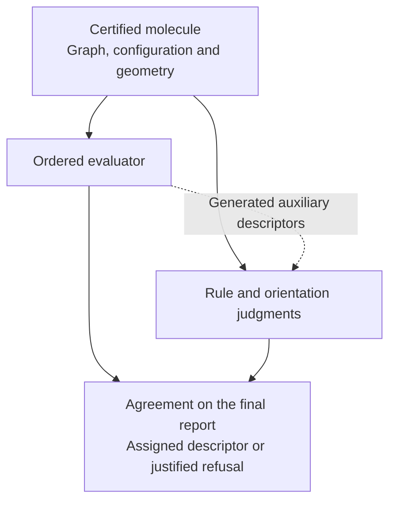
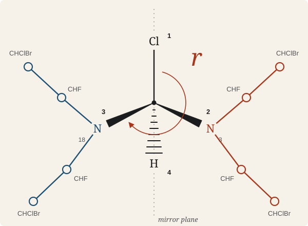

# Stereolib

Stereolib uses Lean 4 to check how the Cahn–Ingold–Prelog (CIP) sequence rules and a molecule’s
three-dimensional geometry determine a tetrahedral descriptor. For a restricted class of
acyclic molecules, the evaluator has a proof for its entire report, including justified
refusals. For rings, the public molecular API completes ordinary hydrogens, supplies selected pyramidal
frames and returns a report only when all admitted orientations of unplaced P–H bonds agree.
Its recursive source and presentation theorems characterize this named procedure. Independent
chemical fidelity remains open: an admitted spiro witness reverses its final carbon descriptor
when auxiliary Rule 1b distances are measured from the active focus instead of the original root.

[Ring proof status](RING_STATUS.md) · [Run or replay the ring evaluator](docs/ring-evaluator.md) ·
[Proved acyclic results](#what-is-proved) · [Collaborate](#collaborate)

## Ring results as of 25 November 2026

| Result | What the evidence establishes |
| --- | --- |
| Recursive full-path source report | On one admitted, prepared geometry, each requested atom has a unique source-derived result, including refusals and repeated requests. [Report theorem](TetraStereo/Engine/RingFullPathReport.lean) |
| Reachable Rule 4b discrepancy | The grouped root assigns R/S on a 41-atom ring while whole-sphere full-path ordering leaves it unassigned. The eight frozen auxiliary hands agree. [Molecular control](validation/ring-chronology/Rule4bCrossParent.lean) |
| Public presentation invariance | Bond-list permutations preserve the raw public request through hydrogen placement and consensus, including failure and invalid IDs. Independently admitted presentations may also vary stored neighbor order under the theorem's graph and coordinate hypotheses. [Graph theorem](TetraStereo/Engine/RingBondRecordOrder.lean) |
| A scheduled ligand comparison | When constitutional rules tie for a pair at an eligible occurrence, the grouped evaluator derives the first deciding stereochemical rule, or a tie, and its signed score on the original and reflected geometries. [Lean theorem](TetraStereo/Engine/RingGroupedStereo.lean#L323) |
| A change of deciding rule | On a 17-atom ring fixture, Rule 5 gives +2 on the original geometry and −2 on its reflection. Exchanging two coordinates makes Rule 4b decide with −1 on both. [Executable control](validation/ring-chronology/GroupedStereo.lean) |
| A 31-atom ring with frozen auxiliary labels | The grouped comparison returns the expected scores for Rules 4a, 4b, 4c and 5, and for a complete tie. A variant with constitutionally matched sibling branches checks both a Rule 4b decision and a tie. [Fixture and assertions](TetraStereo/Examples/RingRetainedUnitControl.lean) |
| Exact reports for the regenerated profile | Under the stated admission and calibration hypotheses, independently specified priorities determine the letter, casing or refusal at every detected centre for this reference policy. [Exact report certificate](TetraStereo/Engine/LocalizedChemicalRingExactCertificate.lean) |
| A limit of the pinned Centres 1.0 procedure | Renumbering two carbons changes its fluorospiro descriptor from `S` to `s`. The independent ring-pair calculation gives `S` under both numberings and `R` on reflection. [Renumbering witness](TetraStereo/Examples/CentresRingSpiroCasing.lean) · [Molecular calculation](TetraStereo/Examples/RingTwoPairFluorospiro.lean) |

The public `Engine.ringMolecularReportFromRaw?` is
[`RingHydrogenReport.fromRaw?`](TetraStereo/Engine/RingHydrogenReport.lean). It completes ordinary
hydrogens and evaluates the whole requested list over the orientations of unplaced P–H bonds.
A successful result preserves zero-based requested IDs, order, repeats and completed refusals.
Outer `none` includes invalid admission or coordinates, invalid IDs, and disagreement or failed
admission among the placement readings. A completed refusal remains `(id, none)` inside a
successful report. [Domain characterization](TetraStereo/Engine/RingHydrogenReportDomain.lean) ·
[Public aliases](TetraStereo/Engine/PublicAPI.lean)

The current procedure repairs the earlier mixed explicit/implied hydrogen cyclopropane witness
and the missing phosphorus auxiliaries in the oxirane witness. The former now refuses; the latter
returns carbon s/s and phosphorus R/S then S/R. Selected pyramidal frames include neutral
three-coordinate P, As and Sb, and structurally selected bridgehead and N-alkyl oxaziridine
nitrogen. These are scoped eligibility rules, not a universal inventory of stable centres.
[Chemical controls](validation/ring-chronology/LocalRuleCoverage.lean) ·
[Frame selector](TetraStereo/Engine/RingPyramidalPublication.lean)

The public recursion uses full-path whole-sphere Rule 4b ordering. On its ready molecular store,
the reference-population and four-list procedures give the same score for valid arms tied through
Rule 4a. A signed priority-path inventory reconstructs complete ordinary ties and strict
priorities. These results retain the evaluator's earlier priorities and auxiliary readings.
The separate grouped API keeps parent-by-parent traversal: on the 41-atom control it assigns R/S
where the public full-path report refuses, despite the same eight leaf hands.
[Population theorem](TetraStereo/Engine/RingPopulationReport.lean) ·
[Inventory report](TetraStereo/Engine/RingStereoInventoryReport.lean) ·
[Cross-parent control](validation/ring-chronology/Rule4bCrossParent.lean)

**Rule 1b after rerooting remains a chemical interpretation question.** On a hydrogen-complete
13-atom spiro graph, the public original-root distance convention gives R/S; the alternative
active-focus convention gives S/R. Four auxiliary readings change. Pinned Centres with the same
policy change reproduces the reversal; Jmol agrees with the public convention on these coordinates.
Agreement of programs does not settle the normative choice. Lean proves store/report equality on
specified graph domains and locates the changed auxiliary occurrence when final reports differ.
[Coordinate witness and trace](validation/ring-chronology/OriginMetricSpiro.lean) ·
[Alternative raw evaluator](TetraStereo/Engine/RingOriginMetricReport.lean) ·
[Disagreement theorem](TetraStereo/Engine/RingOriginCausal.lean)

An auxiliary mismatch need not change a final descriptor. The VS084 fixture, using published
one-based atom numbers, finds R versus S on path 4–5–6–7–1–2–3 in batch 4 for root 4,
while that root keeps S/R. Its strict constitutional order fixes the root independently of
auxiliary stores; root 1 has store agreement. The fixture records the computation, and a separate
Lean theorem proves immunity of strict constitutional tetrahedral roots. The remaining challenge
is determining which disagreements propagate at roots whose constitution ties.
[VS084 replay](validation/ring-chronology/OriginTwinVS084.lean) ·
[Strict-root theorem](TetraStereo/Engine/RingOriginTwinStore.lean)

The accumulated-reference regenerated, grouped, public hydrogen-consensus and pinned Centres
procedures remain distinct. Internal source exactness does not establish full CIP correctness.
Independent justification of internal-edge priorities, rule applicability, centre coverage,
reference lifetime, promotion decisions and external source approval remains open.
See [ring status](RING_STATUS.md) and the [API guide](docs/ring-evaluator.md).

## The proved connection



**Proved:** this final-report connection on the explicitly restricted acyclic physical domain
below, with no molecule-size bound. **Still open:** agreement with the full independent `CIPSpec`
across the intended domain, including general rings with interdependent centres. The dotted arrow
shows why a final-report theorem using the evaluator's own intermediate labels is not yet that
full fixed-point theorem.

## What is proved

[`DeclarativeCIP`](TetraStereo/OneCenter/DeclarativeCIP.lean) supplies a relational framework,
parameterized by rule and orientation judgments. The acyclic final-report theorem instantiates it with
[`multiReferenceProblem`](TetraStereo/OneCenter/DeclarativeCIPMultiReferenceProblem.lean) and
[`geometricOrientation`](TetraStereo/OneCenter/LocalizedActualOrderedRootDeclarativeDescriptor.lean).
Its `CIPSpec` expresses simultaneous consistency of the descriptor map with the specification.
Each result below holds under its linked domain definition.

Here, *acyclic* means without rings, *root* is the centre currently being evaluated,
*auxiliary descriptors* are intermediate labels used during recursive comparisons, and
*refusal* means returning no descriptor.

### Whole-molecule final report

At every detected centre, the ordered evaluator's optional outcome equals the specified outcome.
It refuses exactly when nothing is licensed, without assuming evaluator success.
See [`final_outcome_iff`](TetraStereo/OneCenter/LocalizedOrderedPhysicalMoleculeCorrectness.lean).

**Scope:** any finite size in the [acyclic physical domain](TetraStereo/OneCenter/LocalizedOrderedPhysicalMoleculeDomain.lean):
single bonds, constant charge, no double-bond records; calibrated rigid or terminal-twin non-root
centres; properly distinguishable root branches and corresponding root geometry.

This result uses the evaluator's own intermediate descriptors; it does not yet establish the full
independent `CIPSpec` connection.

### Eight-rule root connection

The ordered comparison returns `gt`/`lt` exactly for declarative strict priority in the corresponding
direction, and `eq` exactly when all eight ordinary rules tie. Multiple equally nearest reference
centres are supported. See the [comparison theorems](TetraStereo/OneCenter/LocalizedActualOrderedRootEightRuleConnection.lean).

**Scope:** the same acyclic physical domain. Rules 3 and 4c add no decision after earlier rules
tie on this domain; general Rule 6 correctness is not established.

### Multi-reference fixture

<p align="center">
  <a href="TetraStereo/OneCenter/LocalizedTwoReferenceFixtureRootLetter.lean">
    
  </a>
</p>

The ordered evaluator's root descriptor is pseudoasymmetric `r`. Two mirror-image nitrogen arms
tie on every rule before Rule 5, which separates them. See
[`root_letter`](TetraStereo/OneCenter/LocalizedTwoReferenceFixtureRootLetter.lean).

*Schematic of the root, with atom numbers from the Lean fixture. The two nitrogen arms are
mirror-related; Rule 5 puts arm 3 before arm 18. The complete 33-atom input and geometry are in
the linked source.*

**Scope:** one [33-atom molecule](TetraStereo/OneCenter/LocalizedTwoReferencePseudoasymmetryFixture.lean)
that exercises the general machinery.

### Cyclic root keys

At the rule-major evaluator's final root, a prior tie holds exactly for physically enantiomorphic
ligand pairs. See [`priorTie_iff_enantiomorphic`](TetraStereo/OneCenter/LocalizedCyclicRootPhysicalCorrectness.lean).

**Scope:** [rings allowed](TetraStereo/OneCenter/LocalizedCyclicRootPhysicalSetup.lean), with single
bonds, constant charge, calibrated rigid or terminal-twin non-root centres, properly distinguishable
root branches and corresponding root geometry.

The whole-molecule result consults the evaluator's own auxiliary descriptors and does not
establish `CIPSpec` at every auxiliary occurrence. These results do not establish assignment
correctness for general rings or for every evaluator path in the library.
[`assert_kernel_only`](TetraStereo/KernelOnly.lean) guards the whole-molecule, fixture and cyclic
endpoints and the lemmas behind the eight-rule connection. It admits only Lean's three standard
axioms, and it rejects `sorry` and native-evaluation trust. Whether the specification is faithful
to chemistry is a separate scientific question, and we want experts to press on it.

## The proof frontier

The regenerated exact-source interface joins letters, casing and refusals for its named
procedure. The public hydrogen-consensus report has a separate recursive source characterization
and presentation theorems. The earlier hydrogen and phosphorus failure cases are repaired;
the rerooted Rule 1b witness exposes a remaining normative choice with observable final effects.
Internal source derivations retain their local definitions and do not establish independent
chemical fidelity. See [RING_STATUS.md](RING_STATUS.md) and the [API guide](docs/ring-evaluator.md).

The domain hypotheses, including single bonds and constant formal charge, also need separate
extensions toward the intended molecular domain. The earlier acyclic results and fixture above
remain useful scoped results; they do not by themselves establish the full independent `CIPSpec`.

## Collaborate

Start with one claim, one hypothesis or one molecule. Contributions can review a rule
interpretation, simplify a proof, supply a counterexample, or take ownership of a larger argument.

- **Lean and formal-methods researchers:** independent recursive comparison coverage,
  nested-reference fidelity, the full specification join, and simplifying existing proofs.
- **Stereochemists:** whether the concrete rule judgments capture the sequence rules, counterexamples
  (rings, pseudoasymmetry, multiple references), and the intended molecular domain.

You do not need to read Lean proofs to review the chemistry. Start with the prose documentation
of the [concrete rule judgments](TetraStereo/OneCenter/DeclarativeCIPMultiReferenceProblem.lean)
and [geometric orientation](TetraStereo/OneCenter/LocalizedActualOrderedRootDeclarativeDescriptor.lean);
`DeclarativeCIP` describes their framework. Domain fields list the physical hypotheses, and the
fixture is written out atom by atom.

To begin, open a *Proof or specification* issue that names the declaration and the claim boundary
you propose. For chemistry, open a *Chemistry result disagreement* issue with the molecule and your
sequence-rule reasoning. If you have not run the evaluator, enter “not run; proposed counterexample”
in the result field. Counterexamples are useful without a repair. See
[CONTRIBUTING.md](CONTRIBUTING.md).

## Concept map

| Concept | Declaration | Source |
| --- | --- | --- |
| Rule slots and precedence, including proposed Rule 6 promotion | `SequenceRule` | [DeclarativeCIP](TetraStereo/OneCenter/DeclarativeCIP.lean) |
| Concrete ordinary-rule judgments for the scoped bridge | `multiReferenceProblem` | [MultiReferenceProblem](TetraStereo/OneCenter/DeclarativeCIPMultiReferenceProblem.lean) |
| Descriptor from ranked ligand coordinates | `geometricOrientation` | [Geometric orientation](TetraStereo/OneCenter/LocalizedActualOrderedRootDeclarativeDescriptor.lean) |
| Framework priority; tie across all rule slots | `Problem.Higher`, `Problem.Tied` | [DeclarativeCIP](TetraStereo/OneCenter/DeclarativeCIP.lean) |
| Consistent descriptors for a whole molecule | `CIPSpec` | [DeclarativeCIP](TetraStereo/OneCenter/DeclarativeCIP.lean) |
| Final descriptor at a centre, or refusal | `FinalTetrahedralOutcome` | [FinalTetrahedralOutcome](TetraStereo/OneCenter/DeclarativeCIPFinalTetrahedralOutcome.lean) |
| Mirror transport with no proper transport between branches | `Enantiomorphic` | [BranchSymmetry](TetraStereo/OneCenter/RootedTetrahedralBranchSymmetry.lean) |
| Acyclic and cyclic physical domains | `OrderedTreePhysicalDomain`, `CyclicRootPhysicalDomain` | [acyclic](TetraStereo/OneCenter/LocalizedOrderedPhysicalMoleculeDomain.lean), [cyclic](TetraStereo/OneCenter/LocalizedCyclicRootPhysicalSetup.lean) |

## Working with the source

Sources live in [OneCenter](TetraStereo/OneCenter) (models, algorithms, proofs),
[Engine](TetraStereo/Engine), [Certificate](TetraStereo/Certificate),
[Examples](TetraStereo/Examples) and [UniversalProof](TetraStereo/UniversalProof). The
[module inventory](source-modules.json) records 4,617 maintained Lean modules, or 4,618 source
files with the umbrella. A module count is
not a theorem count, and the words "complete" or
"universal" in a name do not override the hypotheses of its declarations.

The toolchain is Lean 4.28.0 with Mathlib v4.28.0. The safe first step is a static check that
needs only Python 3.11+ and Git and does not run Lean:

```sh
python3 -B tools/check_source_tree.py
```

Build only selected modules, under an enforced memory limit, as described in
[BUILDING.md](BUILDING.md). Never start an unrestricted whole-library build. This transformed
source distribution has not been freshly compiled here or rebuilt from a
clean checkout. Publication validation is static only; CI runs static checks only. The
original-source checkpoint and its limits are described in [RING_STATUS.md](RING_STATUS.md).

## Citation and license

Directed by M. Reale, Ph.D. Development and algorithm design are AI-assisted. Cite the exact
commit you used ([CITATION.cff](CITATION.cff)). Licensed under [Apache 2.0](LICENSE).
