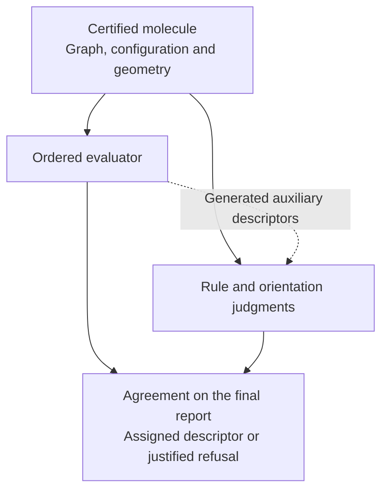

# Proving stereochemical assignments correct

Stereodescriptors such as **R** and **S** describe the three-dimensional configuration at a
molecular centre. The **Cahn–Ingold–Prelog (CIP)** sequence rules rank the groups attached to it.
Stereolib aims to prove that a program assigns these labels correctly throughout an explicitly
defined molecular domain. That universal theorem is **not yet proved**.

The contribution is a formal connection between executable comparisons, separately stated
priority rules, and physical geometry. For a restricted class of molecules without rings, it
proves the whole detected-centre report, including both assigned descriptors and justified
refusals. A 33-atom example derives the lowercase **r** of a pseudoasymmetric centre by comparing
mirror-related branches. We are looking for collaborators to extend this connection to the full
intended domain.

[Current ring status](RING_STATUS.md) · [What is proved](#what-is-proved) · [The proof frontier](#the-proof-frontier) ·
[Collaborate](#collaborate) · [Concept map](#concept-map) · [Working with the source](#working-with-the-source)

## Current source status — 20 November 2026

This update expands the source inventory from 3,714 to **4,129 maintained Lean modules**;
with the umbrella, the distribution contains **4,130 Lean source files**.
The explicit `accumulatedReferencesRegenerated` ring engine now connects its cached execution
to the prepared detected-centre report, including refusals. Independent source-profile
existence and uniqueness, all-root report agreement, and all-root cancellation equality are
established under their stated hypotheses. The concrete DoubleC3 fixture has exact lowercase
`s`, derived auxiliary descriptors and report membership.

Physical results cover transitive roots and roots with at most one moving physical class;
the remaining nontransitive refusals without odd symmetry are necessarily localized to two
moving pairs. Exact independent orientation across those pairs, letters and casing beyond
pairwise proper distinguishability, and normative fidelity of nested reference handling remain
open. These are finite single-bond, constant-charge results with explicit structural admission
and physical calibration hypotheses, not full chemical completion or a release claim.
See [RING_STATUS.md](RING_STATUS.md) for scope, source links and validation limits.

## The proved connection



**Proved:** this final-report connection on the explicitly restricted acyclic physical domain
below, with no molecule-size bound. **Still open:** agreement with the full independent `CIPSpec`
across the intended domain, including general rings with interdependent centres. The dotted arrow
shows why a final-report theorem using the evaluator's own intermediate labels is not yet that
full fixed-point theorem.

## What is proved

[`DeclarativeCIP`](TetraStereo/OneCenter/DeclarativeCIP.lean) supplies a relational framework,
parameterized by rule and orientation judgments. The acyclic final-report theorem instantiates it with
[`multiReferenceProblem`](TetraStereo/OneCenter/DeclarativeCIPMultiReferenceProblem.lean) and
[`geometricOrientation`](TetraStereo/OneCenter/LocalizedActualOrderedRootDeclarativeDescriptor.lean).
Its `CIPSpec` expresses simultaneous consistency of the descriptor map with the specification.
Each result below holds under its linked domain definition.

Here, *acyclic* means without rings, *root* is the centre currently being evaluated,
*auxiliary descriptors* are intermediate labels used during recursive comparisons, and
*refusal* means returning no descriptor.

### Whole-molecule final report

At every detected centre, the ordered evaluator's optional outcome equals the specified outcome.
It refuses exactly when nothing is licensed, without assuming evaluator success.
See [`final_outcome_iff`](TetraStereo/OneCenter/LocalizedOrderedPhysicalMoleculeCorrectness.lean).

**Scope:** any finite size in the [acyclic physical domain](TetraStereo/OneCenter/LocalizedOrderedPhysicalMoleculeDomain.lean):
single bonds, constant charge, no double-bond records; calibrated rigid or terminal-twin non-root
centres; properly distinguishable root branches and corresponding root geometry.

This result uses the evaluator's own intermediate descriptors; it does not yet establish the full
independent `CIPSpec` connection.

### Eight-rule root connection

The ordered comparison returns `gt`/`lt` exactly for declarative strict priority in the corresponding
direction, and `eq` exactly when all eight ordinary rules tie. Multiple equally nearest reference
centres are supported. See the [comparison theorems](TetraStereo/OneCenter/LocalizedActualOrderedRootEightRuleConnection.lean).

**Scope:** the same acyclic physical domain. Rules 3 and 4c add no decision after earlier rules
tie on this domain; general Rule 6 correctness is not established.

### Multi-reference fixture

<p align="center">
  <a href="TetraStereo/OneCenter/LocalizedTwoReferenceFixtureRootLetter.lean">
    
  </a>
</p>

The ordered evaluator's root descriptor is pseudoasymmetric `r`. Two mirror-image nitrogen arms
tie on every rule before Rule 5, which separates them. See
[`root_letter`](TetraStereo/OneCenter/LocalizedTwoReferenceFixtureRootLetter.lean).

*Schematic of the root, with atom numbers from the Lean fixture. The two nitrogen arms are
mirror-related; Rule 5 puts arm 3 before arm 18. The complete 33-atom input and geometry are in
the linked source.*

**Scope:** one [33-atom molecule](TetraStereo/OneCenter/LocalizedTwoReferencePseudoasymmetryFixture.lean)
that exercises the general machinery.

### Cyclic root keys

At the rule-major evaluator's final root, a prior tie holds exactly for physically enantiomorphic
ligand pairs. See [`priorTie_iff_enantiomorphic`](TetraStereo/OneCenter/LocalizedCyclicRootPhysicalCorrectness.lean).

**Scope:** [rings allowed](TetraStereo/OneCenter/LocalizedCyclicRootPhysicalSetup.lean), with single
bonds, constant charge, calibrated rigid or terminal-twin non-root centres, properly distinguishable
root branches and corresponding root geometry.

The whole-molecule result consults the evaluator's own auxiliary descriptors and does not
establish `CIPSpec` at every auxiliary occurrence. These results do not establish assignment
correctness for general rings or for every evaluator path in the library.
[`assert_kernel_only`](TetraStereo/KernelOnly.lean) guards the whole-molecule, fixture and cyclic
endpoints and the lemmas behind the eight-rule connection. It admits only Lean's three standard
axioms, and it rejects `sorry` and native-evaluation trust. Whether the specification is faithful
to chemistry is a separate scientific question, and we want experts to press on it.

## The proof frontier

The ring programme has moved beyond the earlier source-profile and all-root cancellation
obligations. Its remaining frontier is independent two-pair physical orientation, exact letters
and casing outside the pairwise-properly-distinguishable domain, and chemical fidelity of the
accumulated-reference/regeneration policy at nested occurrences. The detailed boundary and
current endpoints are in [RING_STATUS.md](RING_STATUS.md).

The domain hypotheses, including single bonds and constant formal charge, also need separate
extensions toward the intended molecular domain. The earlier acyclic results and fixture above
remain useful scoped results; they do not by themselves establish the full independent `CIPSpec`.

## Collaborate

Start with one claim, one hypothesis or one molecule. Contributions can review a rule
interpretation, simplify a proof, supply a counterexample, or take ownership of a larger argument.

- **Lean and formal-methods researchers:** independent two-pair orientation, exact non-PPD
  descriptors, the full specification join, and simplifying existing proofs.
- **Stereochemists:** whether the concrete rule judgments capture the sequence rules, counterexamples
  (rings, pseudoasymmetry, multiple references), and the intended molecular domain.

You do not need to read Lean proofs to review the chemistry. Start with the prose documentation
of the [concrete rule judgments](TetraStereo/OneCenter/DeclarativeCIPMultiReferenceProblem.lean)
and [geometric orientation](TetraStereo/OneCenter/LocalizedActualOrderedRootDeclarativeDescriptor.lean);
`DeclarativeCIP` describes their framework. Domain fields list the physical hypotheses, and the
fixture is written out atom by atom.

To begin, open a *Proof or specification* issue that names the declaration and the claim boundary
you propose. For chemistry, open a *Chemistry result disagreement* issue with the molecule and your
sequence-rule reasoning. If you have not run the evaluator, enter “not run; proposed counterexample”
in the result field. Counterexamples are useful without a repair. See
[CONTRIBUTING.md](CONTRIBUTING.md).

## Concept map

| Concept | Declaration | Source |
| --- | --- | --- |
| Rule slots and precedence, including proposed Rule 6 promotion | `SequenceRule` | [DeclarativeCIP](TetraStereo/OneCenter/DeclarativeCIP.lean) |
| Concrete ordinary-rule judgments for the scoped bridge | `multiReferenceProblem` | [MultiReferenceProblem](TetraStereo/OneCenter/DeclarativeCIPMultiReferenceProblem.lean) |
| Descriptor from ranked ligand coordinates | `geometricOrientation` | [Geometric orientation](TetraStereo/OneCenter/LocalizedActualOrderedRootDeclarativeDescriptor.lean) |
| Framework priority; tie across all rule slots | `Problem.Higher`, `Problem.Tied` | [DeclarativeCIP](TetraStereo/OneCenter/DeclarativeCIP.lean) |
| Consistent descriptors for a whole molecule | `CIPSpec` | [DeclarativeCIP](TetraStereo/OneCenter/DeclarativeCIP.lean) |
| Final descriptor at a centre, or refusal | `FinalTetrahedralOutcome` | [FinalTetrahedralOutcome](TetraStereo/OneCenter/DeclarativeCIPFinalTetrahedralOutcome.lean) |
| Mirror transport with no proper transport between branches | `Enantiomorphic` | [BranchSymmetry](TetraStereo/OneCenter/RootedTetrahedralBranchSymmetry.lean) |
| Acyclic and cyclic physical domains | `OrderedTreePhysicalDomain`, `CyclicRootPhysicalDomain` | [acyclic](TetraStereo/OneCenter/LocalizedOrderedPhysicalMoleculeDomain.lean), [cyclic](TetraStereo/OneCenter/LocalizedCyclicRootPhysicalSetup.lean) |

## Working with the source

Sources live in [OneCenter](TetraStereo/OneCenter) (models, algorithms, proofs),
[Engine](TetraStereo/Engine), [Certificate](TetraStereo/Certificate),
[Examples](TetraStereo/Examples) and [UniversalProof](TetraStereo/UniversalProof). The
[module inventory](source-modules.json) lists all 4,129 maintained Lean modules. Together with
the original `TetraStereo.lean` umbrella, there are 4,130 Lean source files. A module count is
not a theorem count, and the words "complete" or
"universal" in a name do not override the hypotheses of its declarations.

The toolchain is Lean 4.28.0 with Mathlib v4.28.0. The safe first step is a static check that
needs only Python 3.11+ and Git and does not run Lean:

```sh
python3 -B tools/check_source_tree.py
```

Build only selected modules, under an enforced memory limit, as described in
[BUILDING.md](BUILDING.md). Never start an unrestricted whole-library build. This transformed
source distribution has not been freshly compiled here or rebuilt from a
clean checkout. Publication validation is static only; CI runs static checks only. The
original-source checkpoint and its limits are described in [RING_STATUS.md](RING_STATUS.md).

## Citation and license

Directed by M. Reale, Ph.D. Development and algorithm design are AI-assisted. Cite the exact
commit you used ([CITATION.cff](CITATION.cff)). Licensed under [Apache 2.0](LICENSE).
