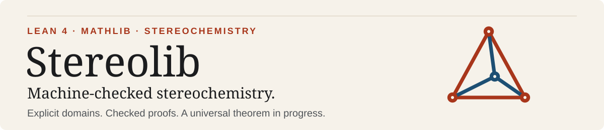
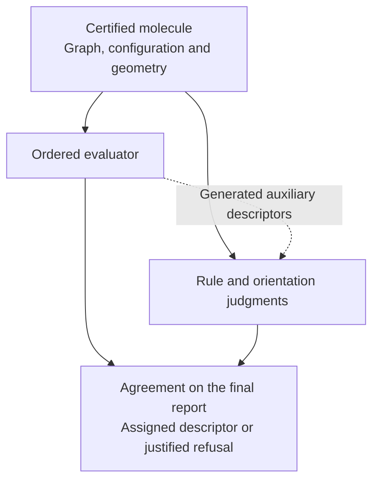

# Stereolib

Stereolib uses Lean 4 to check how the Cahn–Ingold–Prelog (CIP) sequence rules and a molecule’s
three-dimensional geometry determine a tetrahedral descriptor. For a restricted class of
acyclic molecules, the evaluator has a proof for its entire report, including justified
refusals. For rings, the public full-path molecular evaluator now derives its recursive report from
molecular path priorities, coordinate readings and deeper auxiliary assignments. A reachable
41-atom counterexample distinguishes it from the existing grouped report. A chemical correctness
proof for every admitted ring remains open.

[Ring proof status](RING_STATUS.md) · [Run or replay the ring evaluator](docs/ring-evaluator.md) ·
[Proved acyclic results](#what-is-proved) · [Collaborate](#collaborate)

## Ring results as of 24 November 2026

| Result | What the evidence establishes |
| --- | --- |
| Recursive full-path source report | Every requested atom has a unique complete source-derived result on admitted coordinates, including refusals and repeated requests. [Report theorem](TetraStereo/Engine/RingFullPathReport.lean) |
| Reachable Rule 4b discrepancy | The grouped root assigns R/S on a 41-atom ring while whole-sphere full-path ordering leaves it unassigned. The eight frozen auxiliary hands agree. [Molecular control](validation/ring-chronology/Rule4bCrossParent.lean) |
| Presentation invariance | Permuting bond records preserves complete grouped reports and selected grouped/cached reports under the theorem's admission hypotheses. [Graph theorem](TetraStereo/Engine/RingBondRecordOrder.lean) |
| A scheduled ligand comparison | When constitutional rules tie for a pair at an eligible occurrence, the grouped evaluator derives the first deciding stereochemical rule, or a tie, and its signed score on the original and reflected geometries. [Lean theorem](TetraStereo/Engine/RingGroupedStereo.lean#L323) |
| A change of deciding rule | On a 17-atom ring fixture, Rule 5 gives +2 on the original geometry and −2 on its reflection. Exchanging two coordinates makes Rule 4b decide with −1 on both. [Executable control](validation/ring-chronology/GroupedStereo.lean) |
| A 31-atom ring with frozen auxiliary labels | The grouped comparison returns the expected scores for Rules 4a, 4b, 4c and 5, and for a complete tie. A variant with constitutionally matched sibling branches checks both a Rule 4b decision and a tie. [Fixture and assertions](TetraStereo/Examples/RingRetainedUnitControl.lean) |
| Exact reports for the regenerated profile | Under the stated admission and calibration hypotheses, independently specified priorities determine the letter, casing or refusal at every detected centre for this reference policy. [Exact report certificate](TetraStereo/Engine/LocalizedChemicalRingExactCertificate.lean) |
| A limit of the pinned Centres 1.0 procedure | Renumbering two carbons changes its fluorospiro descriptor from `S` to `s`. The independent ring-pair calculation gives `S` under both numberings and `R` on reflection. [Renumbering witness](TetraStereo/Examples/CentresRingSpiroCasing.lean) · [Molecular calculation](TetraStereo/Examples/RingTwoPairFluorospiro.lean) |

The [public molecular report](TetraStereo/Engine/RingMolecularReport.lean) has a finite recursive
source derivation for every requested atom on admitted coordinates, with request order and
duplicates preserved. At each reachable frame it derives both geometries' ordinary priorities,
Rule 5 comparisons, complete promotion trials and coordinate hands. Opposite trial votes cancel;
the two surviving hands determine letter and case. Every site completes, including refusals.
[Publication theorem](TetraStereo/Engine/RingFullPathPublication.lean)

Import `TetraStereo.Engine.PublicAPI` and call `Engine.ringMolecularReportFromRaw?` with a raw
molecule, exact coordinates and zero-based atom IDs. Its raw-to-graph theorem derives every
requested row along simple bonded paths, including the deeper auxiliary reads. Invalid input,
inadmissible coordinates or an out-of-range ID fail the request; a row with no labels is a
completed refusal. [Raw API and graph theorem](TetraStereo/Engine/RingMolecularReport.lean)

Four distinct constitutional ranks decide a centre before any stereo suffix or promotion is
read. The same zero-duplicate-mass shortcut applies at each queued auxiliary; ties use the
full-path rule on its frozen store. Lean proves the fast state and report equal the full-path
source procedure without appealing to grouped publication.
[Constitutional theorem](TetraStereo/Engine/RingFullPathConstitution.lean)

The public grouped API retains its parent-by-parent Rule 4b traversal. On a reachable frozen
state, it assigns R/S to a 41-atom ring where whole-sphere full-path comparison leaves the root
unassigned. Both see the same eight auxiliary hands; the difference is their cross-parent
ordering. Earlier grouped/rebuilt equality proofs remain valid for that procedure.
[Counterexample](validation/ring-chronology/Rule4bCrossParent.lean) ·
[Full-path graph derivation](TetraStereo/Engine/RingFullPathPairs.lean)

At the original root, the graph proof now justifies skipping Rule 6 with fewer than three
root duplicates. Bond-record permutations preserve complete grouped reports and selected
cached reports. These invariance results do not assign an absolute descriptor to the admitted
single-bond derivative used to expose Jmol's presentation defect.
[Root-return theorem](TetraStereo/Engine/RingRootReturn.lean) ·
[Bond-order theorem](TetraStereo/Engine/RingBondRecordOrder.lean)

**The remaining chemical proof** must justify the priorities inherited at internal edges and
the conditions for applying each rule. For example, the Rule 5 edge key uses the lowercase
stage without a separate local Rule 4b stage. Agreement with the intended chemical rules
therefore still needs an independent proof. Broader domain coverage and external source
review also remain open.
[Proof status and controls](RING_STATUS.md#domain-and-remaining-work)

## The proved connection



**Proved:** this final-report connection on the explicitly restricted acyclic physical domain
below, with no molecule-size bound. **Still open:** agreement with the full independent `CIPSpec`
across the intended domain, including general rings with interdependent centres. The dotted arrow
shows why a final-report theorem using the evaluator's own intermediate labels is not yet that
full fixed-point theorem.

## What is proved

[`DeclarativeCIP`](TetraStereo/OneCenter/DeclarativeCIP.lean) supplies a relational framework,
parameterized by rule and orientation judgments. The acyclic final-report theorem instantiates it with
[`multiReferenceProblem`](TetraStereo/OneCenter/DeclarativeCIPMultiReferenceProblem.lean) and
[`geometricOrientation`](TetraStereo/OneCenter/LocalizedActualOrderedRootDeclarativeDescriptor.lean).
Its `CIPSpec` expresses simultaneous consistency of the descriptor map with the specification.
Each result below holds under its linked domain definition.

Here, *acyclic* means without rings, *root* is the centre currently being evaluated,
*auxiliary descriptors* are intermediate labels used during recursive comparisons, and
*refusal* means returning no descriptor.

### Whole-molecule final report

At every detected centre, the ordered evaluator's optional outcome equals the specified outcome.
It refuses exactly when nothing is licensed, without assuming evaluator success.
See [`final_outcome_iff`](TetraStereo/OneCenter/LocalizedOrderedPhysicalMoleculeCorrectness.lean).

**Scope:** any finite size in the [acyclic physical domain](TetraStereo/OneCenter/LocalizedOrderedPhysicalMoleculeDomain.lean):
single bonds, constant charge, no double-bond records; calibrated rigid or terminal-twin non-root
centres; properly distinguishable root branches and corresponding root geometry.

This result uses the evaluator's own intermediate descriptors; it does not yet establish the full
independent `CIPSpec` connection.

### Eight-rule root connection

The ordered comparison returns `gt`/`lt` exactly for declarative strict priority in the corresponding
direction, and `eq` exactly when all eight ordinary rules tie. Multiple equally nearest reference
centres are supported. See the [comparison theorems](TetraStereo/OneCenter/LocalizedActualOrderedRootEightRuleConnection.lean).

**Scope:** the same acyclic physical domain. Rules 3 and 4c add no decision after earlier rules
tie on this domain; general Rule 6 correctness is not established.

### Multi-reference fixture

<p align="center">
  <a href="TetraStereo/OneCenter/LocalizedTwoReferenceFixtureRootLetter.lean">
    
  </a>
</p>

The ordered evaluator's root descriptor is pseudoasymmetric `r`. Two mirror-image nitrogen arms
tie on every rule before Rule 5, which separates them. See
[`root_letter`](TetraStereo/OneCenter/LocalizedTwoReferenceFixtureRootLetter.lean).

*Schematic of the root, with atom numbers from the Lean fixture. The two nitrogen arms are
mirror-related; Rule 5 puts arm 3 before arm 18. The complete 33-atom input and geometry are in
the linked source.*

**Scope:** one [33-atom molecule](TetraStereo/OneCenter/LocalizedTwoReferencePseudoasymmetryFixture.lean)
that exercises the general machinery.

### Cyclic root keys

At the rule-major evaluator's final root, a prior tie holds exactly for physically enantiomorphic
ligand pairs. See [`priorTie_iff_enantiomorphic`](TetraStereo/OneCenter/LocalizedCyclicRootPhysicalCorrectness.lean).

**Scope:** [rings allowed](TetraStereo/OneCenter/LocalizedCyclicRootPhysicalSetup.lean), with single
bonds, constant charge, calibrated rigid or terminal-twin non-root centres, properly distinguishable
root branches and corresponding root geometry.

The whole-molecule result consults the evaluator's own auxiliary descriptors and does not
establish `CIPSpec` at every auxiliary occurrence. These results do not establish assignment
correctness for general rings or for every evaluator path in the library.
[`assert_kernel_only`](TetraStereo/KernelOnly.lean) guards the whole-molecule, fixture and cyclic
endpoints and the lemmas behind the eight-rule connection. It admits only Lean's three standard
axioms, and it rejects `sorry` and native-evaluation trust. Whether the specification is faithful
to chemistry is a separate scientific question, and we want experts to press on it.

## The proof frontier

The regenerated exact-source interface joins letters, casing and refusals for its named
procedure. The separate full-path evaluator now has its own recursive molecular source theorem. The frontier is independent chemical fidelity of
recursive priorities, auxiliary publication and nested reference handling. Grouped molecular
comparisons and checked examples extend that connection under explicit coverage and agreement
hypotheses. They do not establish a universal correspondence to IUPAC or to the pinned release.
See [RING_STATUS.md](RING_STATUS.md) and the [API guide](docs/ring-evaluator.md).

The domain hypotheses, including single bonds and constant formal charge, also need separate
extensions toward the intended molecular domain. The earlier acyclic results and fixture above
remain useful scoped results; they do not by themselves establish the full independent `CIPSpec`.

## Collaborate

Start with one claim, one hypothesis or one molecule. Contributions can review a rule
interpretation, simplify a proof, supply a counterexample, or take ownership of a larger argument.

- **Lean and formal-methods researchers:** independent recursive comparison coverage,
  nested-reference fidelity, the full specification join, and simplifying existing proofs.
- **Stereochemists:** whether the concrete rule judgments capture the sequence rules, counterexamples
  (rings, pseudoasymmetry, multiple references), and the intended molecular domain.

You do not need to read Lean proofs to review the chemistry. Start with the prose documentation
of the [concrete rule judgments](TetraStereo/OneCenter/DeclarativeCIPMultiReferenceProblem.lean)
and [geometric orientation](TetraStereo/OneCenter/LocalizedActualOrderedRootDeclarativeDescriptor.lean);
`DeclarativeCIP` describes their framework. Domain fields list the physical hypotheses, and the
fixture is written out atom by atom.

To begin, open a *Proof or specification* issue that names the declaration and the claim boundary
you propose. For chemistry, open a *Chemistry result disagreement* issue with the molecule and your
sequence-rule reasoning. If you have not run the evaluator, enter “not run; proposed counterexample”
in the result field. Counterexamples are useful without a repair. See
[CONTRIBUTING.md](CONTRIBUTING.md).

## Concept map

| Concept | Declaration | Source |
| --- | --- | --- |
| Rule slots and precedence, including proposed Rule 6 promotion | `SequenceRule` | [DeclarativeCIP](TetraStereo/OneCenter/DeclarativeCIP.lean) |
| Concrete ordinary-rule judgments for the scoped bridge | `multiReferenceProblem` | [MultiReferenceProblem](TetraStereo/OneCenter/DeclarativeCIPMultiReferenceProblem.lean) |
| Descriptor from ranked ligand coordinates | `geometricOrientation` | [Geometric orientation](TetraStereo/OneCenter/LocalizedActualOrderedRootDeclarativeDescriptor.lean) |
| Framework priority; tie across all rule slots | `Problem.Higher`, `Problem.Tied` | [DeclarativeCIP](TetraStereo/OneCenter/DeclarativeCIP.lean) |
| Consistent descriptors for a whole molecule | `CIPSpec` | [DeclarativeCIP](TetraStereo/OneCenter/DeclarativeCIP.lean) |
| Final descriptor at a centre, or refusal | `FinalTetrahedralOutcome` | [FinalTetrahedralOutcome](TetraStereo/OneCenter/DeclarativeCIPFinalTetrahedralOutcome.lean) |
| Mirror transport with no proper transport between branches | `Enantiomorphic` | [BranchSymmetry](TetraStereo/OneCenter/RootedTetrahedralBranchSymmetry.lean) |
| Acyclic and cyclic physical domains | `OrderedTreePhysicalDomain`, `CyclicRootPhysicalDomain` | [acyclic](TetraStereo/OneCenter/LocalizedOrderedPhysicalMoleculeDomain.lean), [cyclic](TetraStereo/OneCenter/LocalizedCyclicRootPhysicalSetup.lean) |

## Working with the source

Sources live in [OneCenter](TetraStereo/OneCenter) (models, algorithms, proofs),
[Engine](TetraStereo/Engine), [Certificate](TetraStereo/Certificate),
[Examples](TetraStereo/Examples) and [UniversalProof](TetraStereo/UniversalProof). The
[module inventory](source-modules.json) records 4,414 maintained Lean modules, or 4,415 source
files with the umbrella. A module count is
not a theorem count, and the words "complete" or
"universal" in a name do not override the hypotheses of its declarations.

The toolchain is Lean 4.28.0 with Mathlib v4.28.0. The safe first step is a static check that
needs only Python 3.11+ and Git and does not run Lean:

```sh
python3 -B tools/check_source_tree.py
```

Build only selected modules, under an enforced memory limit, as described in
[BUILDING.md](BUILDING.md). Never start an unrestricted whole-library build. This transformed
source distribution has not been freshly compiled here or rebuilt from a
clean checkout. Publication validation is static only; CI runs static checks only. The
original-source checkpoint and its limits are described in [RING_STATUS.md](RING_STATUS.md).

## Citation and license

Directed by M. Reale, Ph.D. Development and algorithm design are AI-assisted. Cite the exact
commit you used ([CITATION.cff](CITATION.cff)). Licensed under [Apache 2.0](LICENSE).
